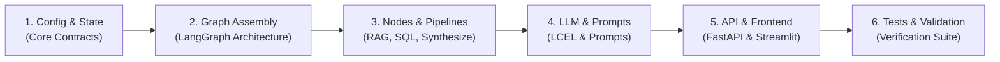

# Codebase Reading Guide: From Start to End

Welcome! If you are reviewing or onboarding into this repository, this guide walks you through the codebase in logical order—starting from the foundation (configuration and state) and following the execution journey of a user request down to persistence and the user interface.

---

## 🗺️ High-Level Map: Where to Start & Where to End



---

## Step 1: Core Contracts & Settings (The Foundation)

Start here to understand how configuration works and how state flows immutably through the system.

1. **`app/core/config.py`**
   - **What it does:** Type-safe settings loaded with `pydantic-settings`.
   - **Key highlights:** Configures multi-provider LLM support (`Ollama`, `OpenAI`, `Anthropic`, `Groq`, `Google`, `HuggingFace`), database connection URLs, vector DB endpoints, and rate limits.
2. **`app/domain/state.py`**
   - **What it does:** Defines `GraphState`—the single source of truth for LangGraph.
   - **Key highlights:** All models inherit from `Frozen` (`extra="forbid"`, immutable). State reducers (`operator.add`) are used for conversation history, branch results, and failures.
3. **`app/domain/deltas.py`**
   - **What it does:** Defines typed Delta classes returned by nodes (e.g. `ClassifyDelta`, `SqlGenerateDelta`, `SynthesizeDelta`).
   - **Architecture rule:** Nodes **never** return raw arbitrary dictionaries; they return typed deltas mapped via `apply_delta()`.
4. **`app/graph/adapters.py`**
   - **What it does:** The single bridge that translates typed Pydantic deltas into state update dictionaries.

---

## Step 2: The LangGraph State Machine (The Blueprint)

Before reading individual nodes, look at how the entire orchestration graph is assembled.

1. **`docs/ARCHITECTURE.md`** & **`README.md`**
   - View the overall architectural mermaid diagram.
2. **`app/graph/builder.py`**
   - **What it does:** Constructs the LangGraph `StateGraph(GraphState)`.
   - **Key highlights:**
     - Registers all 14 graph nodes wrapped with `logged_node`.
     - Sets entrypoint to `condense_question`.
     - Defines linear edges and conditional routing edges.
3. **`app/graph/routers.py`**
   - **What it does:** Contains the conditional edge branching functions:
     - `route_after_classify`: routes to `rag_retrieve`, `sql_generate`, parallel `sql_rag_split` (two LangGraph `Send` commands), `direct_reply`, or `refuse`.
     - `route_after_validate`: determines whether SQL proceeds to `sql_execute` or goes to `sql_repair` / `circuit_breaker`.
     - `route_after_execute`: inspects SQL execution success or routes to `sql_repair`.

---

## Step 3: Following the Execution Journey (Node by Node)

Follow the path of an incoming message as it traverses the graph:

### Phase A: Question Condensing & Intent Classification
1. **`app/graph/nodes/condense_question.py`**
   - Retrieves recent chat turns for the thread from Postgres and resolves pronouns (e.g., "how much did they pay?" $\rightarrow$ "how much did customer John Doe pay?").
2. **`app/graph/nodes/classify_route.py`**
   - Classifies user intent into:
     - `documents` $\rightarrow$ Document RAG pipeline.
     - `database` $\rightarrow$ Text-to-SQL pipeline.
     - `combined` $\rightarrow$ Both pipelines in parallel.
     - `chitchat` $\rightarrow$ Casual greetings and small talk.
     - `refuse` $\rightarrow$ Out-of-scope or unsafe queries.

### Phase B: Document Pipeline (RAG)
1. **`app/graph/nodes/rag_retrieve.py`**
   - Embeds question and queries Qdrant vector store.
2. **`app/services/rag.py` & `app/repositories/vector.py`**
   - Business service and repository interacting with Qdrant and embeddings.
3. **`app/graph/nodes/rag_answer.py`**
   - Synthesizes an answer grounded strictly in retrieved chunks with filename and snippet citations.

### Phase C: Structured Data Pipeline (Text-to-SQL)
1. **`app/graph/nodes/sql_generate.py`**
   - Generates read-only PostgreSQL query based on business schema (`customers`, `orders`, `order_items`, `products`, `refunds`).
2. **`app/graph/nodes/sql_validate.py` & `app/services/sql.py`**
   - **Security layer:** Uses `sqlglot` AST parsing.
   - Enforces SELECT-only queries, table whitelisting, blocked dangerous functions (`pg_sleep`, file I/O), forbidden schemas, single statement limit, and auto-injected LIMIT caps.
3. **`app/graph/nodes/sql_repair.py`**
   - If validation or execution fails, LLM receives the previous SQL and specific error message to attempt repair (up to 3 attempts).
4. **`app/graph/nodes/circuit_breaker.py`**
   - Trips if 3 repair attempts fail, generating a safe explanation without exposing database internals.
5. **`app/graph/nodes/sql_execute.py` & `app/repositories/sql.py`**
   - Executes validated query using read-only Postgres credentials with explicit statement timeouts.
6. **`app/graph/nodes/sql_answer.py`**
   - Summarizes raw rows into natural language.

### Phase D: Edge Branches
1. **`app/graph/nodes/direct_reply.py`**
   - Handles greetings/pleasantries directly without expensive tool calls.
2. **`app/graph/nodes/refuse.py`**
   - Politely refuses unsupported questions.

### Phase E: Convergence & Persistence
1. **`app/graph/nodes/synthesize.py`**
   - If `combined` route was selected, merges both RAG answer and SQL answer into a unified cited response.
   - If single branch, acts as clean pass-through.
2. **`app/graph/nodes/persist_and_log.py`**
   - Persists assistant response and queries into PostgreSQL conversation memory tables for thread tracking.

---

## Step 4: LLM Abstraction & Prompts

Explore how prompts and LLM backends are cleanly separated:

1. **`app/llm/factory.py`** & **`app/llm/models/`**
   - Factory returning LangChain ChatModels and Embeddings dynamically based on environment config (`get_llm()`, `get_embeddings()`), delegating to modular provider files in `app/llm/models/` (`ollama.py`, `openai.py`, `anthropic.py`, `groq.py`, `google.py`, `huggingface.py`).
2. **`app/prompts/`**
   - **Zero inline prompt rule:** All prompts live here under application (`condense.py`, `router.py`, `rag_answer.py`, `sql_generate.py`, `sql_repair.py`, `sql_summarize.py`, `synthesize.py`).
3. **`app/llm/chains.py`**
   - Assembles LCEL (LangChain Expression Language) chains coupling prompts with LLMs.

---

## Step 5: Web API & User Interface

See how external clients interact with the assistant:

1. **`app/main.py`**
   - FastAPI lifespan (DB pooling, Qdrant bootstrapping), middleware (request ID, rate limiting), and exception handlers.
2. **`app/api/routes/chat.py`**
   - `POST /chat`: Main endpoint accepting `message` and `thread_id`.
3. **`app/api/routes/documents.py`**
   - `POST /documents/ingest`: File upload and chunking (PDF, DOCX, TXT, MD).
4. **`frontend/app.py`**
   - Streamlit dashboard providing chat interface alongside real-time live **Data Inspector** displaying executed SQL, route choice, and document citations.

---

## Step 6: Tests & Quality Gates (Where to End)

Conclude by reviewing how correctness, immutability, and security are enforced:

1. **`tests/unit/`**
   - `test_sql_validator.py`: SQL injection and AST safety validation matrix.
   - `test_state_immutability.py`: Ensures GraphState rejects mutations.
   - `test_no_dict_rule.py`: AST test verifying nodes do not return raw dicts.
   - `test_synthesize_matrix.py`: Test matrix for combined and fallback answers.
2. **`tests/graph/`**
   - `test_routing.py`, `test_circuit_breaker.py`, `test_sql_repair_loop.py`: Graph state machine behavior.
3. **`tests/integration/`**
   - `test_api.py`, `test_thread_isolation.py`, `test_readonly_role.py`.

---

## ⚡ Quick Command Reference

Run quality gates in order:

```bash
# 1. Lint checks
uv run ruff check app tests

# 2. Formatter verification
uv run ruff format --check app tests

# 3. Strict type checking
uv run mypy app --strict

# 4. Full test suite (188 tests)
uv run pytest
```
